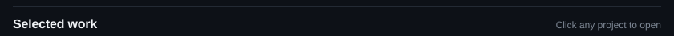
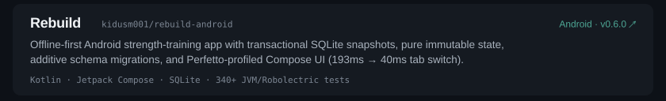
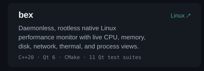
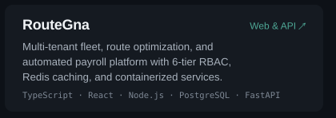
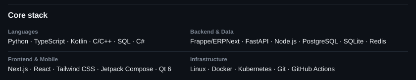

<!-- profile:start -->

<picture><source media="(prefers-color-scheme: dark)" srcset="./assets/header-dark.svg"><source media="(prefers-color-scheme: light)" srcset="./assets/header-light.svg"></picture>

&nbsp;&nbsp;&nbsp;<a href="mailto:kidusmesfin27@gmail.com"><picture><source media="(prefers-color-scheme: dark)" srcset="./assets/social-email-dark.svg"><source media="(prefers-color-scheme: light)" srcset="./assets/social-email-light.svg"></picture></a>&nbsp;&nbsp;<a href="https://t.me/crosscodething"><picture><source media="(prefers-color-scheme: dark)" srcset="./assets/social-telegram-dark.svg"><source media="(prefers-color-scheme: light)" srcset="./assets/social-telegram-light.svg"></picture></a>&nbsp;&nbsp;<a href="https://x.com/kidus_m27"><picture><source media="(prefers-color-scheme: dark)" srcset="./assets/social-x-dark.svg"><source media="(prefers-color-scheme: light)" srcset="./assets/social-x-light.svg"></picture></a>

<picture><source media="(prefers-color-scheme: dark)" srcset="./assets/terrain-dark.svg"><source media="(prefers-color-scheme: light)" srcset="./assets/terrain-light.svg"></picture>

<picture><source media="(prefers-color-scheme: dark)" srcset="./assets/sec-work-dark.svg"><source media="(prefers-color-scheme: light)" srcset="./assets/sec-work-light.svg"></picture>

<a href="https://github.com/kidusm001/rebuild-android"><picture><source media="(prefers-color-scheme: dark)" srcset="./assets/proj-rebuild-dark.svg"><source media="(prefers-color-scheme: light)" srcset="./assets/proj-rebuild-light.svg"></picture></a>
<a href="https://github.com/kidusm001/bex"><picture><source media="(prefers-color-scheme: dark)" srcset="./assets/proj-bex-dark.svg"><source media="(prefers-color-scheme: light)" srcset="./assets/proj-bex-light.svg"></picture></a>
<a href="https://github.com/kidusm001/multi-fleet-managment"><picture><source media="(prefers-color-scheme: dark)" srcset="./assets/proj-routegna-dark.svg"><source media="(prefers-color-scheme: light)" srcset="./assets/proj-routegna-light.svg"></picture></a>

<picture><source media="(prefers-color-scheme: dark)" srcset="./assets/stack-dark.svg"><source media="(prefers-color-scheme: light)" srcset="./assets/stack-light.svg"></picture>

<!-- profile:end -->
